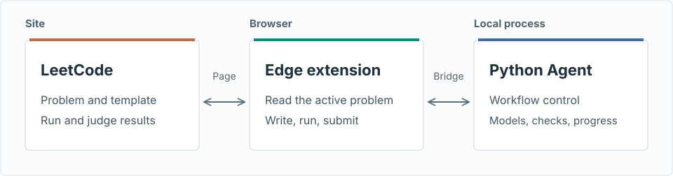
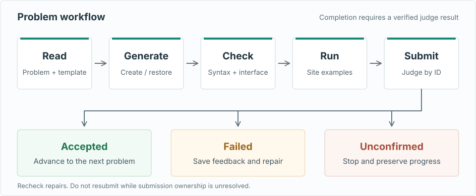

# Agent4PS

A local agent for solving LeetCode China algorithm problems in Python 3 through your active Microsoft Edge tab. It reads the problem and official template, generates a candidate, runs checks, submits to the site when configured, and repairs or advances using judge feedback and saved progress.

The Python orchestrator controls the workflow; the language model supplies candidate code and reviews. Automatic completion requires a confirmed submission ID, matching code, and an **Accepted** result. The project is intended for one user on a Windows machine, with manual login and intervention when site state cannot be verified.

[Setup](docs/setup.md) · [Workflow and recovery](docs/workflow.md) · [Configuration](docs/configuration.md) · [Troubleshooting](docs/troubleshooting.md)

## Architecture

<picture>
  <source media="(max-width: 600px)" srcset="docs/diagrams/architecture-mobile.svg">
  
</picture>

| Component | Responsibility |
| --- | --- |
| `Orchestrator` | Select the next step; control review, repair, search, submission, and stopping budgets. |
| `ProblemCatalog` and `ExtensionBrowser` | Read the problem, Python3 template, site-run results, and submission feedback. |
| `ModelClient` | Generate, review, repair, and optionally describe problem images using configured models. |
| `BrowserBridge` and the Edge extension | Pair over `127.0.0.1`, edit the active problem tab, run, submit, and navigate. |
| `ProgressStore` and `ArtifactStore` | Persist the cursor, candidates, checks, references, and submission-confirmation state. |

Browser cookies remain in Edge. The model API receives the problem, template, candidate code, and relevant failure feedback. Public solution search is a fallback after the configured failure threshold.

## Quick start

Requires Windows, Python 3.12+, Microsoft Edge, a LeetCode China account, and a working model endpoint. Run from the repository root:

```powershell
py -3.12 -m venv .venv
.\.venv\Scripts\python.exe -m pip install -e .
.\.venv\Scripts\Activate.ps1
$secret = Read-Host 'Model API key' -AsSecureString
$env:INTERN_AI_API_KEY = [System.Net.NetworkCredential]::new('', $secret).Password
Remove-Variable secret
```

Check the endpoint and model IDs in [`config.yaml`](config.yaml). `api.key_env` contains the environment-variable name, never the secret value.

1. At `edge://extensions`, enable **Developer mode**, choose **Load unpacked**, and select [`browser-extension/`](browser-extension/).
2. Sign in to [leetcode.cn](https://leetcode.cn/) in that Edge profile. Open an algorithm problem and keep its tab active.
3. Run `python -m leetcode_agent doctor` to check Edge, extension files, the catalog, and the configured model. This command uses the network and makes a model request.
4. Start `run` (or `python -m leetcode_agent run`), open the Agent4PS extension popup, and enter the six-digit pairing code shown by this process. Match the popup's port to `browser.port`.

The default configuration enables automatic submission. Review [`workflow.auto_submit`](docs/configuration.md) before starting. See [setup](docs/setup.md) for pairing, updates, and supported command forms.

## Run, inspect, and resume

```powershell
run
python -m leetcode_agent status
# Stop the running process with Ctrl+C, then restart to resume.
```

`run --start-current` explicitly selects the active problem, subject to saved-work protections. An unconfirmed submission is checked read-only before another submission is attempted. Manual site acceptance is recorded separately from an automatically verified agent submission. See [workflow and recovery](docs/workflow.md).

<picture>
  <source media="(max-width: 600px)" srcset="docs/diagrams/problem-flow-mobile.svg">
  
</picture>

## Repository layout

| Path | Contents |
| --- | --- |
| [`leetcode_agent/`](leetcode_agent/) | Python package: CLI, bridge, model client, workflow, checks, and persistence. |
| [`browser-extension/`](browser-extension/) | Edge Manifest V3 extension, page hook, and pairing popup. |
| [`docs/`](docs/) | Setup, configuration, recovery, troubleshooting, and responsive SVG diagrams. |
| [`tests/`](tests/) | Python regression tests and Node.js extension tests. |
| [`config.yaml`](config.yaml) | Endpoint, model IDs, environment-variable name, and workflow settings. |

Supporting documents use lowercase, hyphen-separated filenames. Python package/module identifiers retain underscores. Runtime state is stored in the existing `Output/` directory and is excluded from Git; it is not part of the source layout.

## Development

```powershell
python -m pip install pytest
python -m pytest -q
node --test tests/extension-hook.test.mjs tests/extension-background.test.mjs
```

Node.js is needed only for the JavaScript tests. Python browser-integration tests use Playwright with the installed Edge browser when Playwright is available; install it with `python -m pip install playwright` to run those tests. These tests use synthetic pages, not a live LeetCode solving session.

## Data and limitations

- Pairing tokens are stored in `.local/` and extension storage. Keep these, model keys, and full `Output/` records out of public commits.
- Local checks execute model-generated Python in a restricted subprocess with a timeout, not an operating-system sandbox.
- The extension depends on LeetCode China's page structure and APIs. Login challenges, rate limits, and ambiguous submission ownership can require manual intervention.
- Only `leetcode.cn` algorithm problems and Python3 are supported. A passed example run is not an Accepted submission; the project does not guarantee a fixed solve time or success rate.

The documentation structure was informed by [leetcode-mcp-server](https://github.com/jinzcdev/leetcode-mcp-server) and [browser-use](https://github.com/browser-use/browser-use). They are documentation references, not runtime dependencies. Actual dependencies are declared in [`requirements.txt`](requirements.txt) and [`pyproject.toml`](pyproject.toml).
